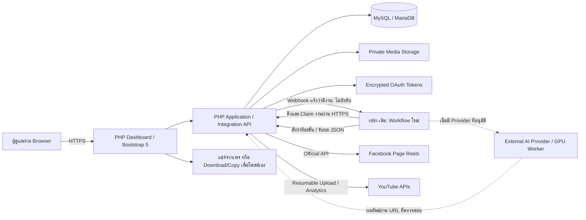
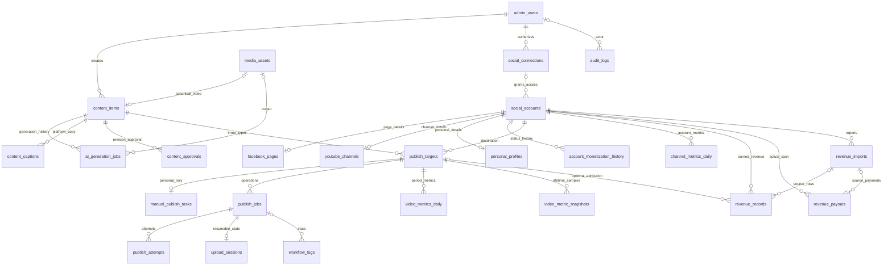
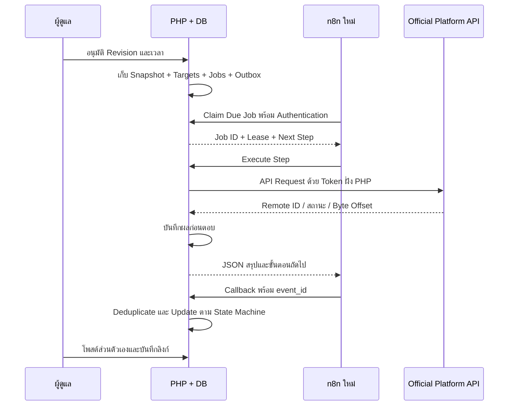

# แบบระบบ Hybrid AI Auto Post Studio V1.0

เอกสารฉบับเสนออนุมัติ 0.1 • วันที่ 13 พฤศจิกายน 2569 (Asia/Bangkok)

อ้างอิง Master Prompt V3.3 และคำตอบของเจ้าของโครงการในแชต เอกสารนี้เป็นการออกแบบ ยังไม่มี PHP Source Code, SQL Migration หรือ Workflow JSON ที่พร้อมนำไปติดตั้ง

## 1. ขอบเขตและข้อกำหนดที่ยืนยันแล้ว

- ผู้ดูแล 1 คน ใช้ Dashboard ภาษาไทยแบบ Responsive ด้วย PHP + MySQL/MariaDB + Bootstrap 5
- เว็บไซต์ที่แจ้ง: https://krusomkhuan.com บน Shared Hosting ผู้ใช้เข้าจัดการผ่านเว็บ
- n8n เดิมเข้าจัดการผ่านเว็บ ไม่ใช้ SSH ไม่แก้การติดตั้ง ไม่แก้ Workflow เดิม สร้างเฉพาะ Workflow และ Credentials ใหม่ที่บัญชีอนุญาต
- ปริมาณประมาณ 3–5 คลิปต่อวัน ความยาวเป้าหมาย 30–60 วินาที แนวตั้ง 9:16
- 1 วิดีโอเลือก Facebook Page ได้เพียง 1 เพจ และ YouTube Channel 1 ช่อง
- เพิ่มเพจภายหลังผ่าน OAuth และข้อมูลในฐานข้อมูล ไม่แก้ Source Code และไม่สร้าง Workflow แยกทุกเพจ
- Facebook ส่วนตัวทำด้วยตนเอง และเลือกวิธีต่อคอนเทนต์ได้: แชร์จากเพจ หรืออัปโหลด MP4 เป็นโพสต์ใหม่
- ต้องอนุมัติก่อนเผยแพร่ เก็บสถานะและลิงก์แยกปลายทาง ป้องกันโพสต์ซ้ำ และรองรับสำเร็จบางช่องทาง
- Facebook ส่วนตัวเปิดสร้างรายได้แล้วตาม Master Prompt; Page และ YouTube ยังไม่เปิดสร้างรายได้
- ไม่มี GPU และยังไม่มี Google Cloud OAuth/API; สถานะ Meta App และงบ AI Provider ยังไม่ยืนยัน
- ไม่รองรับ TikTok และไม่ใช้การดึง Cookie หรือ Browser Automation แทน Official API
- ไม่ใช้บริการเสียเงินโดยไม่ได้รับอนุญาต

### 1.1 ข้อมูลที่ยังไม่ทราบและไม่สมมติว่าพร้อม

โดเมนไม่สามารถใช้ยืนยันแพ็กเกจโฮสติ้ง, PHP Extensions, ขนาดอัปโหลด, พื้นที่, Cron, Outbound HTTPS หรือสิทธิ์ติดตั้งโปรแกรมได้ การเปิดเว็บไซต์ด้วยเครื่องมือค้นคว้าในรอบนี้ไม่สำเร็จ จึงยังไม่ได้ตรวจสอบเว็บไซต์หรือเครื่องจริง

รอสำรวจผ่านหน้าเว็บ: เวอร์ชัน PHP/DB, Document Root, SSL, File Manager, phpMyAdmin, upload_max_filesize, post_max_size, memory_limit, max_execution_time, disk quota, bandwidth, WAF, outbound cURL, HTTP Range และความสามารถสร้าง Scheduled Tasks

รอสำรวจ n8n: URL, เวอร์ชัน, Project ที่ใช้งาน, สิทธิ์ Create/Import/Activate Workflow, Create Credentials, Schedule Trigger, HTTP Request และข้อจำกัด execution ห้ามส่ง Password, Access Token หรือ API Secret ในแชต

### 1.2 ข้อเสนอขอบเขตใช้งานเป็นลำดับ

เริ่มจาก Upload/Manual Import และเตรียม Provider Adapter สำหรับ Text-to-Video ไว้ในแบบระบบ การเปิด AI Generation เป็นเงื่อนไขรอเจ้าของเลือก Provider/ทรัพยากรและงบ ไม่ถือว่าฟังก์ชันสร้าง AI Video เสร็จเพียงเพราะมีหน้ากรอก Prompt

การสร้างวิดีโอเคลื่อนไหวจริงยาว 30–60 วินาทีอาจต้องสร้างหลายช่วงแล้วรวมภาพ/เสียง Provider ต้องผ่านการทดสอบความยาว ต้นทุน สิทธิ์ใช้งาน และรูปแบบผลลัพธ์ก่อนรับรองความสามารถ ไม่แทนด้วยภาพนิ่งสไลด์โดยไม่ขออนุมัติ

## 2. System Architecture ที่เสนอ

แยกงานจัดการและจัดเก็บข้อมูลออกจากการควบคุมลำดับงาน โดยให้ PHP เป็นเจ้าของข้อมูลจริง และ n8n เป็น Workflow Engine



### 2.1 หน้าที่ของแต่ละส่วน

**PHP Dashboard:** Login, Page Manager, OAuth Callback, Media Library, การอนุมัติ, คิวงานใน DB, Caption, Manual Publishing, Analytics, Revenue, Audit และ Export

**PHP Integration API:** รับคำสั่งจาก Workflow แล้วเรียก Official API ด้วย Token ฝั่งเซิร์ฟเวอร์ ส่งคืนเฉพาะสถานะ/ID/ผลสรุปให้ n8n การอัปโหลดแบ่งเป็นขั้นตอนที่มีเวลาสิ้นสุด ไม่ใช้ PHP Request เดียวยาวตลอดคลิป

**MySQL:** เป็นแหล่งข้อมูลหลักของสถานะงาน ตารางเวลาที่อนุมัติแล้ว การล็อกงาน ผลเผยแพร่ และบันทึกการส่งซ้ำ ไม่อาศัย n8n Execution History เป็นฐานข้อมูลธุรกิจ

**n8n:** Schedule, Dispatch, Polling, Retry, เรียก PHP API, รวมลำดับงาน และรับ Callback ตามรูปแบบที่กำหนด ใช้เฉพาะ Node มาตรฐานที่มีอยู่ ไม่ติดตั้ง Community Node เพิ่มโดยอัตโนมัติ

**Media Storage:** เสนอให้ใช้ Private Directory ของโฮสติ้งก่อนเมื่อทรัพยากรเพียงพอ เก็บไฟล์นอก Public Web Root และให้ PHP ออกลิงก์ดาวน์โหลดแบบมีอายุ หากโฮสติ้งไม่รองรับ ต้องเปลี่ยนเป็น Object Storage ที่เจ้าของอนุมัติ ไม่เลือกแพ็กเกจเสียเงินเอง

**AI/Video Processing:** อยู่ภายนอก Shared Hosting และ n8n เดิม เว้นแต่โฮสติ้งมีเครื่องมือตรวจไฟล์ที่อนุญาตอยู่แล้ว ไม่วางโมเดล AI หรือกระบวนการเรนเดอร์หนักใน Shared Hosting

### 2.2 เหตุผลที่ n8n รับเฉพาะ Metadata

ข้อเสนอให้ Workflow ส่ง Job ID, Cursor และผล JSON แทนไฟล์ MP4 หรือ Base64 ช่วยลดความเสี่ยงกับ n8n เดิม เอกสาร n8n อธิบายว่า Binary Data ในหน่วยความจำอาจสร้างปัญหากับไฟล์ใหญ่ แต่โครงการนี้จะไม่เปลี่ยน Environment หรือ Binary Storage ของเซิร์ฟเวอร์เดิม [S1]

YouTube จะใช้ PHP ส่งข้อมูลเป็นช่วงจาก Storage ไปยัง Resumable Session และให้ n8n เรียกขั้นตอนถัดไป การแบ่งช่วงเป็นทางเลือกที่ใช้เพื่อจำกัดระยะเวลาคำขอบน Shared Hosting ต้องทดสอบขนาดที่เหมาะจริง เช่น เริ่มทดลอง 4 MiB ซึ่งเป็นผลคูณของ 256 KiB ไม่ถือเป็นค่าที่ผ่านการทดสอบแล้ว [S2]

Facebook ให้ PHP เริ่ม Upload Session และติดตามสถานะ หาก API เวอร์ชันที่เลือกยอมรับ Source URL จะใช้ลิงก์อายุจำกัดให้ Meta ดึงไฟล์โดยตรง อายุลิงก์ต้องครอบคลุมเวลาที่ Meta ใช้ดึงไฟล์ หากวิธีนี้ไม่ผ่านข้อกำหนดจริง ต้องทดสอบ Upload Transport ที่อนุญาตก่อนเปิดใช้ ไม่ย้าย Binary ไป n8n เดิมโดยพลการ

### 2.3 รูปแบบติดตั้งผ่านเว็บ

- แนะนำ Subdomain เช่น studio.krusomkhuan.com เพื่อแยก Session และไฟล์จากเว็บหลัก แต่ยังไม่กำหนดตำแหน่งติดตั้งจนกว่าจะได้รับอนุมัติ
- ส่งมอบ ZIP ที่รวม Dependencies ที่จำเป็นแล้ว ผู้ใช้ไม่ต้องรัน Composer/Node บนโฮสติ้ง
- อัปโหลดด้วย File Manager, ตั้งค่าฐานข้อมูลผ่าน Control Panel, นำเข้า Migration ผ่าน phpMyAdmin และตั้ง Document Root ให้ชี้เฉพาะ Public Directory
- ไฟล์ Config/Secret อยู่ภายนอก Web Root หากทำไม่ได้ต้องมีวิธีปฏิเสธการเข้าถึงที่ตรวจสอบได้ ก่อนนำระบบขึ้นจริง
- ไม่บังคับ Cron ของโฮสติ้ง: ใช้ Schedule Trigger ของ Workflow ใหม่ใน n8n เรียก API; หากบัญชี n8n ไม่อนุญาต Schedule Trigger ให้หยุดส่วนตั้งเวลาไว้รอทางเลือกที่เจ้าของอนุมัติ
- Backup ผ่าน Control Panel/เครื่องมือที่มีอยู่ พร้อมทดสอบ Restore ไม่สมมติว่ามี Command Line

## 3. วงจรคอนเทนต์และกฎธุรกิจ

1. สร้าง Draft จาก Upload, Manual Import หรือ AI Job ที่พร้อมใช้
2. ตรวจไฟล์และสร้าง Media Asset หนึ่งรายการ เก็บ SHA-256 เพื่อรู้ว่าเป็นไฟล์เดิม
3. เลือก Page 1 เพจ, YouTube Channel 1 ช่อง และวิธี Manual ส่วนตัว 1 แบบ
4. เตรียม Caption/Hashtags แยกสามช่องทาง; YouTube มี Title, Description, Privacy, Audience และข้อมูล Synthetic Media เมื่อเกี่ยวข้อง
5. แสดง Preview และตรวจสถานะไฟล์/สิทธิ์/โควตา ผู้ใช้อนุมัติ Revision ที่เห็น
6. บันทึก Snapshot ของไฟล์ Caption บัญชีปลายทาง Privacy และเวลาที่อนุมัติ
7. Scheduler Claim งานที่ถึงเวลา แยกงาน Facebook และ YouTube ไม่บังคับให้สำเร็จพร้อมกัน
8. เก็บ Remote ID ทันทีที่ได้รับ ตามด้วย Processing Status และ Permalink ที่ตรวจสอบได้
9. จัดการ Manual Task ตามวิธีที่เลือก และซิงก์ Analytics ภายหลัง

Draft อาจยังไม่มีปลายทางครบ แต่ก่อนอนุมัติต้องมีครบทั้งสามประเภท การเปลี่ยนเนื้อหา ไฟล์ Caption ปลายทาง หรือเวลา หลังอนุมัติทำให้ต้องอนุมัติ Revision ใหม่ หากมีการเผยแพร่ช่องทางใดแล้ว จะไม่ย้าย Page/Channel ของคอนเทนต์นั้น

### 3.1 สถานะ

- Content: DRAFT → VALIDATING → READY_FOR_REVIEW → APPROVED → SCHEDULED/IN_PROGRESS
- Auto Job: QUEUED → CLAIMED → UPLOADING → PROCESSING → PUBLISHED
- ทางแยก: RETRY_WAIT, AUTH_REQUIRED, FAILED, CANCELLED, UNKNOWN_REMOTE_STATE
- Manual: WAITING_PAGE_PUBLICATION (กรณีแชร์จากเพจ) → WAITING_MANUAL_POST → MANUAL_COMPLETED
- AI: NOT_CONFIGURED, QUEUED, SUBMITTED, GENERATING, SUCCEEDED, FAILED, CANCELLED

แสดงผลรวมสองมุมเสมอ: “อัตโนมัติสำเร็จ 2/2” และ “ส่วนตัวรอดำเนินการ” หากอัตโนมัติสำเร็จเพียงช่องทางเดียวให้เป็น Partial Success; Complete Success ของทั้งคอนเทนต์ต้องสำเร็จครบสามปลายทาง ไม่เปลี่ยน Manual เป็นสำเร็จเอง

### 3.2 Facebook ส่วนตัวสองวิธี

**SHARE_PAGE:** รอ Page เผยแพร่สำเร็จก่อน แสดงปุ่มเปิดโพสต์ต้นทางและคัดลอก Caption ให้ผู้ดูแลแชร์เอง บันทึกลิงก์โพสต์ส่วนตัวและเวลาที่ผู้ดูแลยืนยัน ไม่สร้างการแชร์อัตโนมัติ ไม่ถือว่ายอดวิวหรือรายได้ของ Page เป็นของโปรไฟล์

**UPLOAD_VIDEO:** ให้ Download MP4, Copy Caption, Open Facebook, Post URL และ Mark as Published บันทึกว่าเป็นโพสต์ต้นฉบับของโปรไฟล์ที่ผู้ดูแลยืนยันเอง ไม่ถือว่าการยืนยันด้วยมือเป็นผลตรวจสอบจาก API

อนุญาตเปลี่ยนวิธีก่อนทำ Manual Task เสร็จ โดยเก็บ Audit หากคอนเทนต์เคยอนุมัติแล้วต้องอนุมัติส่วนที่เปลี่ยนใหม่

## 4. Database ERD และ Data Dictionary

### 4.1 หลักการ

ใช้ InnoDB, utf8mb4, PK แบบ BIGINT UNSIGNED และเวลา DATETIME(6) เก็บ UTC; หน้าจอและเวลานัดหมายแสดง Asia/Bangkok วันรายงานเก็บ Timezone ของต้นทางด้วย จำนวนเงินใช้ DECIMAL(20,6) พร้อมรหัสสกุลเงิน ไม่ใช้ Float

เพิ่ม social_accounts เป็นบัญชีกลางเพื่อให้ Analytics/Revenue อ้าง FK จริงได้ทั้ง Page, YouTube และ Personal โดยไม่ใช้รหัสที่ชี้ได้หลายตารางแบบไม่มี FK; social_connections เก็บการอนุญาต OAuth ซึ่งอาจอนุญาตหลายเพจ



ERD แสดงความสัมพันธ์หลัก รายละเอียด PK/FK/Unique/Index ด้านล่างเป็นส่วนหนึ่งของแบบระบบ ตารางสนับสนุนการส่งข้อความและล็อกข้อมูลไม่ใส่ในรูปเพื่อให้อ่านง่าย

### 4.2 ตารางตาม Master Prompt

ทุกตารางใช้ `id` เป็น PK ยกเว้นตารางรายละเอียดบัญชีที่ใช้ `account_id` เป็นทั้ง PK/FK และ system_settings ใช้ `setting_key` เป็น PK; ตารางแก้ไขข้อมูลมี created_at/updated_at ตามความจำเป็น

1. **admin_users** — email, password_hash, active, last_login_at; UNIQUE(email); จำกัด Single Admin ที่ Application/ขั้นตอนติดตั้ง ไม่เปิด Public Registration
2. **system_settings** — setting_key, value, value_type; เก็บค่าทั่วไป ไม่เก็บ Master Encryption Key ใน DB
3. **social_connections** — admin_id FK→admin_users, provider, provider_subject_id, encrypted_access_token, encrypted_refresh_token, expires_at, granted_scopes, status, key_version; UNIQUE(provider, provider_subject_id); INDEX(status, expires_at)
4. **facebook_pages** — account_id PK/FK→social_accounts, page_id, permission_check_at, permissions_status, encrypted_page_token, token_expires_at; UNIQUE(page_id); INDEX(permissions_status)
5. **youtube_channels** — account_id PK/FK→social_accounts, channel_id, channel_title, upload_capability_status; UNIQUE(channel_id)
6. **media_assets** — storage_disk, storage_key, sha256, original_name, MIME, size_bytes, width, height, duration_ms, codecs, validation_status, source_type, retention_until; UNIQUE(storage_disk, storage_key), UNIQUE(sha256); INDEX(validation_status, created_at)
7. **ai_generation_jobs** — content_id FK→content_items, output_asset_id nullable FK→media_assets, provider, provider_job_id, prompt, negative_prompt, requested_duration, style, estimated_cost, actual_cost, currency, status, next_poll_at; UNIQUE(provider, provider_job_id); INDEX(status, next_poll_at)
8. **content_items** — admin_id FK→admin_users, media_asset_id nullable FK→media_assets, title_internal, status, revision, desired_publish_at_utc; UNIQUE(media_asset_id); INDEX(status, desired_publish_at_utc)
9. **content_captions** — content_id FK→content_items, platform, caption, hashtags, youtube_title, revision; UNIQUE(content_id, platform)
10. **publish_targets** — content_id FK→content_items, account_id, platform, approved_revision, target_status, remote_post_id, remote_url, privacy, published_at; composite FK(account_id, platform)→social_accounts(id, platform); UNIQUE(content_id, platform), UNIQUE(account_id, remote_post_id); INDEX(target_status, published_at)
11. **publish_jobs** — target_id FK→publish_targets, operation_type, approval_id FK→content_approvals, idempotency_key, status, due_at, lease_token_hash, lease_expires_at, next_retry_at, attempt_count; UNIQUE(idempotency_key), UNIQUE(target_id, operation_type) สำหรับ initial_publish; INDEX(status, due_at), INDEX(status, next_retry_at)
12. **publish_attempts** — job_id FK→publish_jobs, attempt_no, started_at, finished_at, provider_request_id, sanitized_error_code, error_category, response_summary; UNIQUE(job_id, attempt_no); INDEX(error_category, started_at)
13. **video_metrics_daily** — target_id FK→publish_targets, metric_key, report_date, period_start_utc, period_end_utc, source_timezone, value nullable, availability_status, source_type, source_revision, synced_at; UNIQUE(target_id, metric_key, report_date, source_timezone, source_type); INDEX(report_date, metric_key)
14. **channel_metrics_daily** — account_id FK→social_accounts, metric_key, report_date, period_start_utc, period_end_utc, source_timezone, value nullable, metric_basis, availability_status, source_type, synced_at; UNIQUE(account_id, metric_key, report_date, source_timezone, source_type); INDEX(report_date, metric_key)
15. **revenue_records** — account_id FK→social_accounts, target_id nullable, import_id nullable FK→revenue_imports, metric_type เช่น estimated/earned_final, period_start, period_end, amount, currency, source_type, source_record_key, status, revision; UNIQUE(account_id, source_type, source_record_key); INDEX(account_id, period_start, period_end, currency, metric_type)
16. **revenue_payouts** — account_id FK→social_accounts, import_id nullable FK→revenue_imports, external_payment_key, paid_at, gross_amount, fees, withholding_tax, net_amount, currency, evidence_storage_key; UNIQUE(account_id, external_payment_key); INDEX(account_id, paid_at, currency)
17. **revenue_imports** — account_id FK→social_accounts, uploaded_by FK→admin_users, file_sha256, report_type, format_version, status, period_start, period_end, row_count, accepted_count, rejected_count; UNIQUE(account_id, file_sha256); INDEX(status, created_at)
18. **workflow_logs** — job_id nullable FK→publish_jobs, correlation_id, workflow_key, execution_id, event_type, severity, sanitized_summary, created_at; INDEX(correlation_id), INDEX(workflow_key, created_at)
19. **audit_logs** — admin_id nullable FK→admin_users, actor_type, action, entity_type, entity_id, before_summary, after_summary, request_id, created_at; INDEX(entity_type, entity_id, created_at), INDEX(created_at); append-only ผ่าน Application

### 4.3 ตารางเสริมที่จำเป็น

- **social_accounts:** id PK, connection_id nullable FK→social_connections, platform, external_account_id, display_name, enabled, connection_status; UNIQUE(platform, external_account_id), UNIQUE(id, platform); Personal ไม่ต้องมี OAuth Connection
- **personal_profiles:** account_id PK/FK→social_accounts, profile_url, label; มีโปรไฟล์ส่วนตัวที่ Active เพียงหนึ่งรายการใน V1
- **account_monetization_history:** id PK, account_id FK→social_accounts, status, effective_from, effective_to, source; INDEX(account_id, effective_from); ตรวจช่วงเวลาไม่ให้ซ้อนกันใน Transaction
- **content_approvals:** id PK, content_id FK→content_items, admin_id FK→admin_users, revision, snapshot, snapshot_sha256, approved_at; UNIQUE(content_id, revision); INDEX(approved_at)
- **manual_publish_tasks:** id PK, target_id FK→publish_targets, method, status, source_page_target_id nullable FK→publish_targets, personal_post_url, confirmed_by nullable FK→admin_users, confirmed_at; UNIQUE(target_id)
- **upload_sessions:** id PK, job_id FK→publish_jobs, provider, encrypted_session_uri, remote_upload_id, acknowledged_bytes, total_bytes, expires_at, state; UNIQUE(job_id); INDEX(state, expires_at)
- **video_metric_snapshots:** id PK, target_id FK→publish_targets, metric_key, captured_at, value nullable, availability_status, source_type; UNIQUE(target_id, metric_key, captured_at, source_type); INDEX(target_id, captured_at)
- **integration_events:** id PK, direction, event_id, job_id nullable FK→publish_jobs, event_type, payload_hash, sanitized_payload, status, available_at, delivered_at; UNIQUE(direction, event_id); INDEX(direction, status, available_at) ใช้ทั้ง Inbox Deduplication และ Outbox
- **request_nonces:** id PK, credential_key_id, nonce_hash, expires_at; UNIQUE(credential_key_id, nonce_hash); INDEX(expires_at) ป้องกัน Replay ของ Integration Requests

### 4.4 กฎที่ต้องบังคับหลายระดับ

- platform เป็นชนิดปิด `facebook_page`, `youtube`, `facebook_personal`; UNIQUE(content_id, platform) จึงห้ามเลือกหลายเพจหรือหลายช่อง
- composite FK ของ Target ป้องกันการนำ YouTube Account มาใช้เป็น Facebook Target; รายละเอียดบัญชีแต่ละชนิดต้องตรวจชนิดตรงกันใน Transaction และเพิ่ม CHECK เมื่อ DB เวอร์ชันรองรับจริง
- UNIQUE(media_asset_id) ใน content_items และ UNIQUE(sha256) ใน media_assets ป้องกันสร้างคอนเทนต์ซ้ำจากไฟล์เดิมเพื่อเปลี่ยนเพจ กรณีไฟล์ต่าง Encoding ระบบไม่รับรองว่า SHA-256 จะรู้ว่าเป็นภาพเดียวกัน จึงยังต้องมีคำเตือนและการตรวจของผู้ดูแล
- หนึ่ง Content มี Personal Target และ Manual Task หนึ่งรายการ สร้าง/แก้สาม Target ใน Transaction เดียว; ก่อนอนุมัติตรวจว่าครบทั้งสามประเภท
- SHARE_PAGE ต้องอ้าง Page Target ของ Content เดียวกัน; UPLOAD_VIDEO ไม่อ้าง Page เป็นเจ้าของยอดวิว
- revenue_records ที่มี target_id ต้องใช้ account_id ตรงกับบัญชีของ Target โดยเพิ่ม composite UNIQUE/FK(target_id, account_id) กับ publish_targets(id, account_id)
- Remote ID เป็น String ไม่แปลงเป็น Integer; URLs และชื่อไฟล์ไม่ใช้เป็น Primary Identifier
- ห้ามลบ Page/Channel ที่มีประวัติเผยแพร่ ให้ Disable/Disconnect แทน; FK ประวัติใช้ RESTRICT ไม่ Cascade ลบรายได้หรือ Audit
- Retry ไม่สร้าง initial_publish Job ใหม่ เปลี่ยนเฉพาะ Attempt; งานแก้ Metadata ภายหลังต้องเป็น Operation แยกและไม่สั่ง Upload ใหม่
- DB รุ่นจริงต้องตรวจ Foreign Keys, Transaction และ CHECK ก่อนออก SQL Migrations ไม่พึ่ง CHECK ที่ DB ไม่บังคับใช้

## 5. Admin Dashboard และ Wireframes

Wireframe เป็นโครงสร้างหน้าจอ ไม่มีข้อมูลสถิติจำลองที่อ้างว่าเป็นข้อมูลจริง ยังไม่ใช่ HTML/CSS หรือ Source Code

### 5.1 เมนูหลัก

ภาพรวม • สร้างคอนเทนต์ • คลังวิดีโอ • คิวเผยแพร่ • Facebook ส่วนตัว • บัญชีและเพจ • สถิติ • รายได้ • งานผิดพลาด • ตั้งค่าระบบ

Desktop ใช้ Sidebar กับพื้นที่หลัก Mobile ยุบเป็นเมนู เปิดดู Preview และแก้ Caption ได้โดยไม่ต้องเลื่อนตารางกว้าง

### 5.2 หน้าภาพรวม

```text
Hybrid AI Auto Post Studio                         [บัญชีผู้ดูแล]
[ช่วงวันที่] [บัญชี/เพจ] [เวลาซิงก์ล่าสุด] [สร้างคอนเทนต์]

งานรออนุมัติ | งานถึงกำหนด | Auto สำเร็จ | รอโพสต์ส่วนตัว

ยอดวิวแยกแพลตฟอร์ม          รายได้ประมาณการ | เงินรับจริง
พร้อมชื่อ Metric/แหล่งข้อมูล   แยกสกุลเงินและความพร้อมข้อมูล

แนวโน้มยอดวิวตามช่วงเวลา     งานที่ต้องดำเนินการ
แยกเส้น Page/YouTube/Manual  Token หมดอายุ / งานไม่แน่ชัด

รายการคอนเทนต์ล่าสุด: วิดีโอ | เพจ | YouTube | ส่วนตัว | สถานะ
```

### 5.3 สร้างและอนุมัติคอนเทนต์

```text
[อัปโหลด MP4] [นำเข้าผลลัพธ์] [AI Video: รอเชื่อมต่อ Provider]

Preview / ข้อมูลไฟล์           Facebook Page [เลือกหนึ่งเพจ v]
ความยาว / สัดส่วน / Codec      YouTube Channel [เลือกหนึ่งช่อง v]
ผลตรวจไฟล์ / Revision         ส่วนตัว ( ) แชร์จากเพจ ( ) อัปโหลดใหม่

[Caption Facebook Page] [Title/Description YouTube] [Caption ส่วนตัว]
YouTube: Privacy / Audience / Synthetic Media เมื่อเกี่ยวข้อง

เผยแพร่: ( ) ทันที ( ) ตั้งเวลา [วันเวลา Asia/Bangkok]
รายการตรวจ: ไฟล์ / สิทธิ์ / บัญชี / Caption / โควตาที่ตรวจได้
[บันทึกร่าง] [ส่งตรวจ] [อนุมัติและจัดคิว]
```

ปุ่มอนุมัติแสดงผลที่จะเกิดขึ้นอย่างชัดเจน เลือกเพจแบบ Single Select เท่านั้น AI Tab รับ Prompt/Negative Prompt/Style/Duration ได้ แต่ปุ่มสร้างต้องปิดพร้อมเหตุผลหาก Provider หรือวงเงินยังไม่พร้อม Caption เขียนเองได้เสมอ ไม่บังคับ LLM API

### 5.4 คิวและรายละเอียดการเผยแพร่

แต่ละ Content แสดงสามแถวปลายทาง พร้อมชื่อบัญชี เวลานัด สถานะ Attempt ล่าสุด และ Remote Link ปุ่ม Retry ใช้ได้เฉพาะ Target ที่เข้าเงื่อนไข กรณี UNKNOWN_REMOTE_STATE แสดง “ตรวจสอบผลก่อนลองใหม่” แทนการสร้างโพสต์ซ้ำ

### 5.5 Facebook ส่วนตัว

SHARE_PAGE แสดงลิงก์โพสต์ Page ต้นทาง หากยังไม่สำเร็จแสดงเหตุผลรอ; UPLOAD_VIDEO แสดง Download MP4 ทั้งสองแบบมี Copy Caption, Open Facebook, ช่อง Post URL, วันที่โพสต์จริง และ Mark as Published พร้อมข้อความว่าผู้ดูแลเป็นผู้ยืนยัน

### 5.6 Page/Channel Manager

Connect/Reconnect/Disconnect, ดึงรายการบัญชีที่ได้รับอนุญาต, เปิด/ปิดใช้งาน, สถานะ Permission, Token Expiry เท่าที่ทราบ, เวลาเช็กล่าสุด, สถานะ Monetization และจำนวนคอนเทนต์ ไม่แสดง Token บนหน้าจอ Disconnect เก็บประวัติเดิมและระงับงานใหม่ ไม่ลบโพสต์บนแพลตฟอร์ม

### 5.7 Analytics

ตัวกรองวันที่/เพจ/ช่อง/วิธี Manual, กราฟแยก Metric, Top Videos, ผู้ติดตาม, เวลาซิงก์ล่าสุด, Export CSV และที่มาข้อมูลทุกชุด รายการที่ไม่มีสิทธิ์หรือข้อมูลล่าช้าแสดง “ยังเข้าถึงไม่ได้/รอข้อมูล/ยังไม่ได้เชื่อมต่อ” แทนศูนย์

### 5.8 รายได้

แยกมุมมอง Estimated Revenue, รายได้ที่ยืนยันในรายงาน และ Actual Payout ใช้ช่วงวันที่รายได้กับวันที่จ่ายเงินคนละ Filter เพิ่มรายการเอง/Import พร้อม Preview และตรวจข้อมูลซ้ำ แสดง Currency และ Coverage ไม่มีการบวกรายได้ประมาณการกับเงินรับจริง

## 6. การเชื่อมต่อ n8n และ Workflow Design

### 6.1 สัญญาการเชื่อมต่อ

ใช้ HTTPS JSON API ภายใต้ Application เช่น `/integration/v1/` ชื่อด้านล่างเป็นแบบสัญญา ยังไม่ใช่ Endpoint ที่สร้างแล้ว:

- Claim งาน: Workflow ระบุชนิดงาน รับ Job ID และ Lease ที่มีอายุ ไม่รับ Page ID ตามใจจาก Browser
- Execute Step: รับ Job ID, Lease, Operation และ Expected Revision; PHP อ่านปลายทางจริงจาก DB แล้วทำขั้นตอนที่อนุญาต
- Status: คืนสถานะและ Cursor ที่บันทึกแล้ว ไม่คืน Access Token, Refresh Token หรือ Resumable Session URI
- Callback/Event: รับ event_id, job_id, correlation_id, occurred_at และผลสรุป; ตรวจการส่งซ้ำและ State Transition ก่อนบันทึก
- Sync/Import: เรียกดึงข้อมูลตาม Account ID ที่ระบบอนุญาต ผลลัพธ์มี Metric Key, Source Period, Timezone และ Availability

ทุกคำขอ n8n→PHP ลงลายเซ็น HMAC ของ Method + Path + Timestamp + Nonce + SHA-256 ของ Raw Body ใช้ Credential แยกสำหรับโครงการนี้ ตรวจเวลาและ Nonce ป้องกัน Replay, เปรียบเทียบ Signature แบบ Constant Time และหมุน Key ได้

ฝั่ง n8n ใช้ Header Auth สำหรับ Webhook แจ้งมีงานหากใช้ รูปแบบ HMAC ใน Node ต้องตรวจตามเวอร์ชันและสิทธิ์จริงก่อนทำ Workflow JSON หาก Node มาตรฐานที่มีไม่รองรับ ให้เสนอวิธี Authentication ที่ทำได้จริงเพื่ออนุมัติ ไม่ขอเปิด Environment หรือเพิ่ม Package ใน Server เดิม

PHP ถือ OAuth Tokens และทำ Refresh ภายใต้ DB Lock; n8n Credentials เก็บเฉพาะ Integration Secret ไม่ส่ง Social Tokens ไปยัง Execution Log

### 6.2 ความทนทานและ Idempotency

- ผู้ใช้อนุมัติแล้ว PHP สร้าง Job และ Outbox ใน Transaction เดียว ส่ง Webhook ไม่สำเร็จยังมีงานใน DB ให้ Scheduler ดึง
- Claim งานด้วย Atomic Update/Transaction และ Lease; จำกัด Concurrency เริ่มต้นหนึ่งงานเผยแพร่ในโครงการนี้จนกว่าจะวัดทรัพยากร ไม่เปลี่ยน Global Concurrency ของ n8n
- Idempotency Key ผูก Target + initial_publish; DB UNIQUE กัน Job ซ้ำ ส่วน event_id กัน Callback ซ้ำ
- Lease หมดอายุไม่ได้แปลว่าปลอดภัยที่จะ Upload ใหม่ ต้องตรวจ Upload Session/Remote State ก่อน
- บันทึก Remote ID และ Session ทันทีที่ได้; YouTube Resume ตาม Byte Offset ที่ Provider ยืนยัน ไม่เดาจากจำนวน Byte ที่ PHP เคยส่ง
- Timeout หลัง Provider รับคำสั่งแต่ยังไม่มี Remote ID เป็น UNKNOWN_REMOTE_STATE หยุด Auto Retry และตรวจสอบ ไม่รับประกัน Exactly Once ข้ามระบบที่ไม่มี Idempotency ฝั่ง Provider
- Retry เฉพาะความผิดพลาดชั่วคราว ใช้ Exponential Backoff + Jitter เคารพ Retry-After; ข้อเสนอเริ่มต้น 5 ครั้ง แก้ได้ใน Settings
- Permission/Token ที่แก้ด้วย Refresh ไม่ได้ → AUTH_REQUIRED; ไฟล์ผิดรูปแบบ → FAILED ต้องแก้ต้นเหตุ
- Cancel ยับยั้งงานที่ยังไม่เริ่ม หาก Provider เผยแพร่แล้วไม่แสดงว่าถูกยกเลิกหรือลบสำเร็จ
- หลัง n8n หยุดทำงาน Dashboard ยังเก็บ Draft ได้ แต่แสดงว่า Automation ไม่พร้อม งานนัดหมายอาจช้า ไม่มี SLA ว่าเผยแพร่ตรงวินาที

### 6.3 Workflow ใหม่ที่เสนอ ครบตาม Master Prompt

1. **Create Content Job:** รับสัญญาณ/Claim งาน ตรวจ Revision และส่งไปงานตรวจไฟล์
2. **AI Video Generation:** ตรวจ Provider/โควตา/วงเงิน ส่ง Generation Request และเก็บ Provider Job ID; ปิดจนกว่าจะอนุมัติ Provider
3. **AI Video Status Polling:** Claim งานที่ถึงเวลาตรวจ รับสถานะและ URL ผลลัพธ์ ไม่รอวนใน Execution ยาวตลอดการสร้าง
4. **Media Validation:** สั่งตรวจ Hash/MIME/ขนาด/Metadata; ส่งตรวจเชิงลึกผ่านเครื่องมือที่ได้รับอนุญาตเท่านั้น
5. **Caption Preparation:** จัดรูปแบบข้อความแยกแพลตฟอร์ม; AI ช่วยเขียนเป็น Optional เมื่อมี Provider ข้อความ
6. **Content Approval:** ตรวจ Approval Snapshot จาก PHP ไม่อนุมัติแทนผู้ดูแล
7. **Publishing Scheduler:** Schedule Trigger ดึง Due Jobs ตรวจ Lease แล้วเรียก Publisher; ตรวจ Approval ซ้ำก่อนส่งจริง
8. **Facebook Page Reels Publisher:** Start → Transfer/Fetch → Status → Publish ตาม API ที่ผ่านการทดสอบ → บันทึก Permalink; ใช้ Workflow เดียวทุกเพจ
9. **YouTube Shorts Publisher:** เริ่ม Resumable Session → ส่งช่วงข้อมูลผ่าน PHP → Processing Poll → ตรวจ Privacy/Link; ไม่ระบุ Shorts ด้วย Flag ที่ไม่มีอยู่
10. **Facebook Personal Manual Task:** เปิด Task ตาม Method; SHARE_PAGE ต้องรอ Page สำเร็จ; ไม่มีการโพสต์ส่วนตัวอัตโนมัติ
11. **Facebook Page Analytics Sync:** ดึงเฉพาะเพจ Active และ Metrics ที่ได้รับสิทธิ์; เก็บข้อมูลแยก Page
12. **YouTube Analytics Sync:** เรียก Data/Analytics API ตามสิทธิ์และช่วงรายงาน เก็บช่วงที่ข้อมูลพร้อมจริง
13. **Manual Revenue Import:** รับ Import ID ที่ผู้ดูแล Preview/ยืนยันแล้ว ให้ PHP ตรวจ Schema และ Deduplicate; ไม่ส่งไฟล์รายงานการเงินทั้งหมดเข้าประวัติ n8n
14. **Revenue Aggregation:** รวมช่วงเวลาโดยแยก Account, Revenue Type และ Currency ไม่ผสมกับ Payout
15. **Retry & Error Handling:** เลือกเฉพาะงานที่ Retry ได้ ส่งคำขอ Retry พร้อม Lease และบันทึกสาเหตุ
16. **Publishing Status Callback:** รับ/ส่ง Status Event ตรวจ Signature, Event ID และ Revision ป้องกันสถานะเก่าทับสถานะใหม่

ทั้ง 16 เป็นหน้าที่เชิงตรรกะ สามารถจัดเป็น Parent/Sub-workflows ได้ตามความสามารถบัญชีจริง ตั้งชื่อ Prefix ของโครงการและไม่แตะ Error Workflow ของงานเดิม การเพิ่ม Page เป็นการเพิ่มข้อมูลบัญชี ไม่ Clone Workflow



## 7. Analytics และ Revenue ที่ตีความได้ถูกต้อง

### 7.1 ยอดวิว

- Daily Period Metrics ใช้รวมเป็นเดือน/ปีได้เฉพาะช่วงไม่ซ้อนและ Metric นิยามเดียวกัน
- Lifetime Snapshot เก็บแยก ไม่บวกยอดสะสมของทุกวัน หากหาผลต่างให้ระบุว่าเป็น “ผลต่างยอดสะสม” และจัดการกรณี Provider ปรับยอดลด ไม่ปัดเป็นศูนย์เพื่อกลบการปรับยอด
- ไม่รวมทั้งยอดระดับ Channel กับยอด Video ของ Channel เดียวกันเป็นยอดรวมซ้ำ
- Platform ต่างกันมีนิยาม Views/Plays/Engaged Views ต่างกัน แสดงชื่อ Metric และคำอธิบาย; ยอดข้ามแพลตฟอร์มเป็นผลรวมตามนิยามต้นทาง ไม่ใช่จำนวนผู้ชมไม่ซ้ำ
- YouTube รายวันใช้ Pacific Time ตาม API ไม่ใช่วันไทย เก็บ Source Timezone และแสดงคำอธิบาย การมีรายงานรายวันอย่างเดียวไม่สามารถแบ่งใหม่เป็นวันไทยอย่างแม่นยำได้ [S3]
- ซิงก์ย้อนหลังช่วงที่เลือกได้เพื่อรับการปรับข้อมูล โดย Upsert แทน Append แล้วบวกซ้ำ ข้อเสนอเริ่มต้นย้อนหลัง 7 วันและทบทวนรายเดือนตามโควตา
- ข้อมูล API กับ Manual ที่ครอบคลุม Metric/ช่วงเดียวกันเลือกแหล่งหลักหนึ่งชุด ไม่บวกสองแหล่งเข้าด้วยกัน พร้อมแสดง Provenance
- ผู้ติดตามคือ Snapshot/ยอดคงเหลือ ไม่ใช่จำนวนที่นำมาบวกทุกวัน; Trend ใช้ผลต่างจุดเวลาที่เทียบได้

### 7.2 รายได้

- Estimated Revenue เป็นรายได้ประมาณการของช่วงที่เกิดรายได้; Actual Payout เป็นเงินที่จ่ายจริงตามวันที่รับ ไม่ใช้สองชุดนี้เป็นยอดเดียวกัน
- รายได้จาก Import ต้องมี Account, Period, Currency, Source Reference และชนิดรายได้; Report รายเดือนห้ามกระจายเป็นรายวันโดยเดา
- Import File Hash กันไฟล์ซ้ำ และ Source Record Key/ช่วงรายงานกันข้อมูลซ้ำข้ามไฟล์ หากเป็นรายงานแก้ไขให้ Preview การแทนที่พร้อมเก็บประวัติ
- รายงาน Daily กับ Monthly ที่ทับกันต้องเลือกฐานรวมหนึ่งชุด ไม่บวกทั้งหมด เดือนที่มีข้อมูลไม่ครบต้องแสดง Coverage
- การป้อน Manual ไม่ทับข้อมูล API โดยเงียบ ต้องเลือก Source Priority หรือทำรายการแก้ไขพร้อม Audit
- สกุลเงินต่างกันไม่รวมเป็นยอดบาทเดียวจนกว่าจะมีนโยบายแปลงเงินที่อนุมัติ เก็บอัตราและวันที่หากเปิดใช้ภายหลัง
- RPM = Revenue ÷ Views × 1,000 เฉพาะเมื่อ Revenue Type, Account, Video Scope, ช่วงเวลา และนิยาม Views ตรงกัน ไม่คำนวณถ้าตัวหารเป็นศูนย์/ขาดข้อมูลหรือเป็นคนละฐาน เช่น Shorts Engaged Views กับ Views ทั่วไป
- Facebook ส่วนตัวใช้ Manual Entry/Import เป็นเส้นทางหลักจนกว่าจะพิสูจน์สิทธิ์ API จริง ไม่มีการรับรองว่าแชร์ Page แล้วโปรไฟล์จะมีรายได้
- บัญชียังไม่ Monetized แสดงสถานะนั้น พร้อมความพร้อมข้อมูล แยกจาก “0 ที่ยืนยันโดยรายงาน”; ข้อมูลขาดหายใช้ NULL และ Availability Status
- YouTube แยก Analytics กับ Monetary Scopes; ตรวจ youtube.readonly เพิ่มตามข้อกำหนด reports.query ปัจจุบัน การขอ Scope ต้องสอดคล้องกับฟังก์ชันที่เปิดใช้ ไม่ขอสิทธิ์กว้างทั้งหมดตั้งแต่แรก [S4]

## 8. ข้อจำกัด API, AI และ Shared Hosting

### 8.1 Meta

ใช้ Official Page Reels API เท่านั้น ต้องมี App, OAuth, สิทธิ์จัดการ Page และสิทธิ์ที่ Endpoint เวอร์ชันนั้นกำหนด รายชื่อ Permission เบื้องต้นเพื่อเตรียมตรวจ ได้แก่ pages_show_list, pages_read_engagement, pages_manage_posts และ read_insights สำหรับงานสถิติที่รองรับ ไม่ถือว่าได้สิทธิ์เหล่านี้แล้ว

App Mode, Roles, Advanced Access, App Review และ Business Verification ต้องตรวจตาม Use Case/บัญชีจริงก่อนประกาศว่าเปิดสาธารณะได้ ไม่รับรองว่า Token ใช้ได้ตลอดหรือทุก Metric ยังมีอยู่

กำหนด Graph API Version ใน Config และมี Capability Mapping ของ Metrics ไม่ผูกค่าถาวรใน Workflow คอลัมน์ที่ถูกเลิกใช้ต้องแสดงสถานะ Unsupported ไม่แสดงศูนย์

เอกสาร Reels ของ Meta เปิดตรวจตรงในรอบนี้ติด HTTP 429 จึงยังไม่ยืนยันรายการ Permission ทั้งหมด ข้อจำกัดไฟล์ และ Upload Transport ของเวอร์ชันที่จะใช้ ต้องตรวจเอกสารทางการและทดสอบด้วยบัญชีจริงใน Phase สำรวจก่อนเขียน Connector [S5]

### 8.2 YouTube

ใช้ videos.insert อัปโหลดวิดีโอ ไม่มี Endpoint แยกชื่อ Shorts; การจัดประเภทอาศัยรูปแบบและความยาวตามกฎ YouTube คลิป 9:16 ความยาว 30–60 วินาทีเป็นเป้าหมายของโครงการ ไม่ใช่การอ้างว่า Shorts สูงสุดได้เพียง 60 วินาที [S6]

ใช้ OAuth ของเจ้าของ Channel และเก็บ Refresh Token อย่างปลอดภัย ตรวจสถานะ Consent/Verification/Testing และข้อจำกัดบัญชีจริงก่อนเปิดใช้ Public Upload ไม่รับรองว่าการสร้าง Cloud Project เท่ากับผ่านอนุมัติทุกกรณี

เอกสาร Quota ที่ตรวจวันที่ 13 พฤศจิกายน 2569 ระบุ Bucket ของ videos.insert เริ่มต้น 100 Calls/วัน และ 1 หน่วยต่อ Call ส่วน Endpoint อื่นมีงบของตน ต้องยึด Google Cloud Console ของ Project จริง รวม Retry/Status/Analytics ด้วย ไม่ hardcode โควตาจากข้อมูลเก่า [S7]

การ Upload เสร็จไม่เท่ากับ Processing หรือ Public สำเร็จ เก็บสถานะแยก ตรวจ Privacy จริง Copyright/Policy และข้อกำหนด Synthetic Media เมื่อเกี่ยวข้อง การใช้ AI ไม่รับประกันสิทธิ์สร้างรายได้

### 8.3 Shared Hosting และวิดีโอ

- ไม่รัน Queue Daemon, GPU, Docker หรือ Long-running Worker บนโฮสติ้ง
- ตรวจ PHP 8.4.27+ ตาม Master Prompt หากไม่รองรับต้องเสนอทางเลือกให้อนุมัติ ไม่ลดเวอร์ชันเอง
- Extensions ที่ต้องตรวจ: PDO MySQL, cURL, OpenSSL, Fileinfo, mbstring, JSON และ Sodium หรือ AEAD ที่รองรับ
- ไม่มีการสมมติว่า FFmpeg/ffprobe ใช้ได้ หากไม่มี ต้องเลือกเครื่องมือตรวจ Metadata ที่เชื่อถือได้และได้รับอนุญาตก่อนเปิด Auto Publish เต็มรูปแบบ Browser Preview เป็นเพียงการตรวจช่วย ไม่ใช่การยืนยัน Codec/ความปลอดภัยฝั่งเซิร์ฟเวอร์
- หากต้อง Re-encode/รวมคลิป/ใส่เสียง ให้ใช้บริการภายนอกที่อนุมัติ ระหว่างยังไม่มีให้แจ้งเหตุผลและให้ผู้ใช้แก้ไฟล์ภายนอกแล้วนำเข้า
- Chunk Upload ฝั่ง Browser ช่วยลดขนาด Request ได้ แต่ไม่ข้าม Disk Quota, WAF, PHP Memory หรือ Outbound Policy ต้องทดสอบทั้งขาเข้าและขาออก
- PHP Connector ต้องใช้ Streaming/Bounded Buffers ไม่อ่าน MP4 ทั้งไฟล์เข้าหน่วยความจำ หากแพ็กเกจไม่รองรับ Request ที่ต้องใช้ ต้องถือเป็น Deployment Blocker ไม่ฝืนด้วยการเพิ่ม Timeout เอง
- ประมาณพื้นที่เพื่อวางแผน: 60 วินาทีที่ Video 8 Mbps + Audio 128 kbps ≈ 61 MB/คลิป; 5 คลิป/วัน × 30 วัน ≈ 9.1 GB เฉพาะต้นฉบับ ยังไม่รวม Backup/Temporary Files การส่งสองปลายทาง ≈ 18.3 GB ต่อเดือนก่อน Retry/Download เป็นตัวอย่างคำนวณ ไม่ใช่ขนาดจริงหรือสิทธิ์แพ็กเกจ
- Retention และขนาดไฟล์สูงสุดรออนุมัติตามแพ็กเกจ ห้ามลบไฟล์ที่ยังมีงาน Upload/Manual/Retry ค้างโดยอัตโนมัติ
- ใช้ Open Source สำหรับส่วนที่เหมาะสม แต่ n8n Community ใช้ Sustainable Use License จึงไม่เรียกรวมทุกส่วนว่า OSI Open Source การใช้ n8n ภายในองค์กรต้องอยู่ภายใต้สิทธิ์ของการติดตั้งเดิม [S8]

## 9. Security และการดูแล

- HTTPS ทุกจุด, Password Hash ด้วย password_hash/password_verify, Secure/HttpOnly/SameSite Session Cookie, Session Regeneration และ Login Rate Limit
- CSRF สำหรับทุกการเปลี่ยนข้อมูลจาก Browser, Output Escaping, Prepared Statements และ Authorization แม้มี Admin คนเดียว
- OAuth ใช้ State ผูก Session/เวลา/Redirect URI และ PKCE เมื่อ Provider รองรับและกำหนด ตรวจบัญชีที่อนุญาตก่อนผูก Page/Channel
- Encrypt Tokens ด้วย AEAD และ Key Version; Master Key แยกจาก DB และ Backup ที่เก็บด้วยกัน ไม่ส่งผ่าน Frontend/n8n Logs
- Upload ตรวจขนาด MIME/File Signature, ชื่อไฟล์สุ่ม, ห้าม Execute, Quarantine ก่อนยืนยัน และตรวจ Media Metadata ก่อนอนุมัติ
- Source URLs จาก Provider ต้องจำกัด Host/Protocol ป้องกัน SSRF, Private IP และ Redirect ไปเครือข่ายภายใน ไม่เปิด Import URL อิสระใน V1
- ลิงก์ Media แบบมีอายุ ผูกขอบเขตไฟล์ ไม่ใส่ Social Token ใน URL; ตรวจ Range/HEAD ตามที่ Transport ต้องใช้
- Workflow/API Logs ปิดบัง Token, Signed URLs, Session URI และข้อมูลการเงินที่ไม่จำเป็น ไม่เปิด Debug Dump ใน Production
- Disconnect เพิกถอนสิทธิ์ที่ Provider รองรับ ทำเครื่องหมาย Connection ใช้ไม่ได้ และหยุดงานที่เกี่ยวข้องโดยเก็บประวัติ
- Export CSV ป้องกัน Formula Injection; Import ตรวจ Encoding, Headers, Decimal, Date, Currency และจำกัดขนาด
- Backup เข้ารหัสและทดสอบ Restore แยกการเก็บ Key; Audit การเปลี่ยนบัญชี การอนุมัติ Retry การแก้รายได้และการยืนยัน Manual

## 10. แผนพัฒนาและเกณฑ์ผ่านแต่ละ Phase

### Phase 0 — อนุมัติแบบและตรวจความพร้อม

ตรวจโฮสติ้ง/n8n ผ่านเว็บ เลือกตำแหน่งติดตั้ง ตรวจ PHP/DB/HTTPS/Storage/Upload Transport, ยืนยันสิทธิ์ Workflow และสถานะ Meta App, สร้าง Google Cloud/OAuth ตามขั้นตอนที่อนุญาต ตรวจ Provider ทางเลือกโดยไม่สมัครเสียเงินเอง

เกณฑ์ผ่าน: มีรายการสิ่งที่ใช้งานได้/ติดเงื่อนไขจริง และเจ้าของอนุมัติแบบระบบ ตำแหน่งติดตั้ง และตัวเลือกที่มีผลต่อค่าใช้จ่าย/ทรัพยากร

### Phase 1 — Core Dashboard และ Manual Publishing

สร้าง Login, Schema/Migrations, Media Library, Upload/Validation ที่ผ่านความพร้อม, Content/Caption, Page/Channel Model, Approval Snapshot, Manual สองวิธี, Audit และคู่มือติดตั้งเว็บ

เกณฑ์ผ่าน: เลือก Page/Channel เกินหนึ่งไม่ได้ ไฟล์ซ้ำไม่สร้างคอนเทนต์ใหม่โดยเงียบ อนุมัติ Revision ถูกต้อง และ Manual แยก Share/Upload ชัดเจน ข้อมูลบัญชีที่ยังไม่เชื่อมต่อไม่แสดงเป็นพร้อมโพสต์

### Phase 2 — OAuth และ Auto Publishing

เชื่อม Page Manager/YouTube, สร้าง Workflow ใหม่, Scheduler/Lease/Idempotency, Upload ขั้นตอนย่อย, Polling, Retry และ Callback

เกณฑ์ผ่าน: ทดสอบบัญชีจริงที่อนุญาต เผยแพร่ได้ทั้งสองช่องทาง เก็บ Remote IDs/URLs, Duplicate Trigger ไม่ Upload ซ้ำ, Timeout ไม่ทำ Blind Retry, Partial Success/Token Expiry/Manual Waiting ถูกต้อง และ Workflow เดิมไม่ถูกเปลี่ยน

### Phase 3 — Analytics และ Monetization

เชื่อม Metrics ที่ได้สิทธิ์จริง, Manual Metrics/Revenue Entry, Import Preview, Daily/Monthly/Yearly, Top Videos, Currency/Coverage, Payout และ CSV

เกณฑ์ผ่าน: สถิติตรงรายงานต้นทางตามช่วงที่เทียบได้ ไม่บวกสะสมซ้ำ ไม่ผสม Estimated/Payout ไม่แสดงข้อมูลขาดเป็นศูนย์ และ Import ซ้ำไม่เพิ่มยอดซ้ำ

### Phase 4 — AI Text-to-Video

เชื่อม Provider Adapter ที่เจ้าของเลือก ตรวจโควตาและต้นทุน เก็บ Prompt/Negative Prompt/Style/Duration, Poll ผล, ดาวน์โหลดอย่างปลอดภัย และนำเข้ากระบวนการอนุมัติเดิม

เกณฑ์ผ่าน: สร้างวิดีโอเคลื่อนไหวตามความยาว/คุณภาพที่ตกลงได้จริง มีหลักฐานต้นทุน/สิทธิ์ใช้งาน และ Provider ล่มยังใช้ Manual Import ได้ Phase นี้รอ Provider/ทรัพยากร ไม่รับรองว่าจะทำฟรีได้โดยไม่มี GPU

### Phase 5 — UAT, Security, Backup และส่งมอบ

ทดสอบสิทธิ์ Webhook/Replay/CSRF/Upload, กู้คืน Backup, ทดสอบทรัพยากรที่ 3–5 คลิปต่อวัน, ติดตั้ง ZIP ผ่านเว็บ และจัดทำคู่มือภาษาไทย

เกณฑ์ผ่าน: เจ้าของทดสอบ Flow ตั้งแต่สร้างจนดูผลแยกช่องทาง ได้ผลทดสอบจริงที่ระบุข้อจำกัด ไม่ประกาศ Full V1 เสร็จหาก AI หรือ API ที่อยู่ในขอบเขตยังติดเงื่อนไข

เวลาพัฒนาจะประมาณหลัง Phase 0 เพราะระยะขอสิทธิ์ API และความพร้อม Provider อยู่นอกการควบคุมของการเขียนโค้ด

## 11. สิ่งส่งมอบและการตรวจรับ

ช่วงออกแบบนี้ส่งมอบ SRS ฉบับย่อ, Architecture Diagram, ERD/Data Dictionary, Wireframes, Integration/Workflow Design, Phase Plan และรายการข้อจำกัดในเอกสารเดียว

หลังอนุมัติจึงสร้าง SQL Migrations, PHP Backend/Responsive Dashboard, Page Manager, AI Module ตาม Provider ที่อนุมัติ, Publishing/Manual/Analytics/Revenue Modules, Workflow JSON, .env.example, API Setup Guide, Shared Hosting Installation Guide, Security & Testing Report และ User Manual ภาษาไทย ครบรายการ Master Prompt ทั้ง 18 ข้อ

ทดสอบสำคัญเพื่อรับระบบ: หลายเพจแต่เลือกได้เพจเดียว, เปลี่ยนปลายทางหลังเผยแพร่ไม่ได้, Callback ซ้ำ/ผิดลำดับ, Scheduler ซ้อน, Upload ขาดช่วง, Provider ตอบไม่แน่ชัด, Token Expired, Approval ถูกแก้, แชร์ Page ที่ยังไม่สำเร็จ, Import ซ้ำ/รายงานแก้ไข/ช่วงทับกัน, Timezone ของรายงาน, Revenue NULL และ Restore Backup

## 12. ประเด็นสำหรับเจ้าของตรวจอนุมัติ

1. อนุมัติ Architecture ที่ให้ PHP เก็บ Tokens/ส่งไฟล์เป็นขั้นตอน และ n8n ควบคุมงานผ่าน Metadata โดยไม่แก้ Server เดิม
2. อนุมัติ Model หนึ่งไฟล์/หนึ่ง Content/หนึ่ง Page/หนึ่ง Channel พร้อม Manual สองวิธี และกฎไม่ย้ายปลายทางหลังเผยแพร่
3. อนุมัติให้เริ่ม Upload/Manual Import ก่อน ส่วน AI Text-to-Video เปิดเมื่อมี Provider/ทรัพยากรและงบที่เจ้าของยืนยัน โดยยังเป็นรายการส่งมอบที่ต้องทำให้ครบ
4. ตำแหน่งติดตั้ง: เสนอ studio.krusomkhuan.com แต่รอยืนยัน ห้ามทับเว็บไซต์เดิม
5. สถานะ Meta App และสิทธิ์สร้าง/Activate Workflow กับ Credentials ในหน้าเว็บ n8n ยังต้องตรวจจริง
6. File Size Limit, Retention, AI Budget และ Media Validation Tool รอข้อมูลแพ็กเกจ/การเลือก Provider ไม่ตั้งค่าใช้งานจริงจากสมมติฐาน

การอนุมัติแบบระบบไม่เท่ากับอนุมัติซื้อบริการ ย้ายระบบ เปลี่ยน Hosting หรือติดตั้งสิ่งเพิ่มเติมบน n8n เดิม

## 13. แหล่งอ้างอิงและสถานะการตรวจสอบ

ตรวจเอกสารออนไลน์วันที่ 13 พฤศจิกายน 2569 ไม่ได้ทดสอบ API ด้วยบัญชีของเจ้าของโครงการ และไม่มีผลทดสอบเซิร์ฟเวอร์จริงในเอกสารนี้

- [S1 — n8n: Handle binary data](https://docs.n8n.io/hosting/scaling/binary-data/)
- [S2 — Google: Resumable Uploads](https://developers.google.com/youtube/data/guides/using_resumable_upload_protocol)
- [S3 — Google: Analytics Dimensions และ Report Timezone](https://developers.google.com/youtube/analytics/dimensions)
- [S4 — Google: Analytics reports.query และ OAuth Scopes](https://developers.google.com/youtube/analytics/reference/reports/query)
- [S5 — Meta: Reels Publishing](https://developers.facebook.com/docs/video-api/guides/reels-publishing/) — เปิดตรงติด HTTP 429 ในรอบตรวจนี้ รายละเอียดที่ระบุว่ารอตรวจยังไม่ถือว่ายืนยันแล้ว
- [S6 — YouTube: Understand three-minute Shorts](https://support.google.com/youtube/answer/15424877)
- [S7 — Google: Quota Calculator](https://developers.google.com/youtube/data/determine_quota_cost) และ [videos.insert](https://developers.google.com/youtube/data/reference/rest/v3/videos/insert)
- [S8 — n8n: Which license do I need for my use case?](https://support.n8n.io/article/can-i-use-your-license-for-my-use-case)
